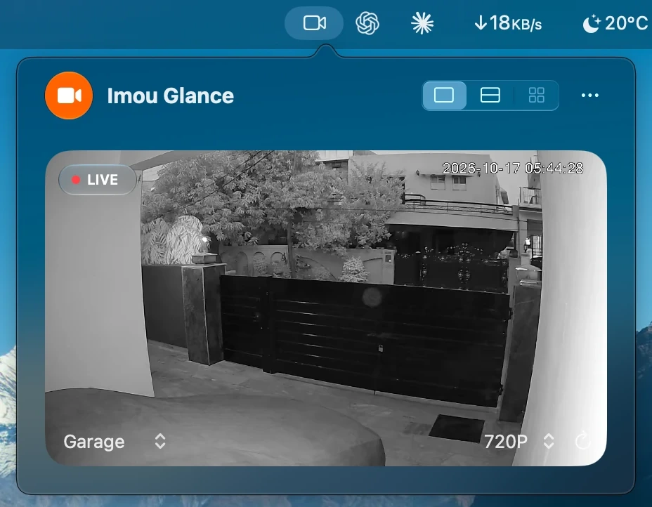

<p align="center">
  
</p>

<h1 align="center">Imou Glance</h1>

<p align="center">
  
  
  
  
  
</p>

A macOS menu bar app for viewing cameras from your Imou account. It signs in
and streams directly. The iPad app does not need to run, and no Screen
Recording permission is required.

<p align="center">
  
</p>

## What it does

- Signs in with an Imou email address or phone number.
- Handles Imou's security puzzle and authorization of this Mac.
- Lists your cameras and retrieves their camera passwords automatically.
- Shows a muted live preview, with one-, two-, or four-camera layouts where available.
- Offers each camera's advertised video qualities, with a separate choice per camera.
- Can remember your sign-in in this Mac's Keychain.

Changing Garage camera frames were confirmed on **17 October 2026** with the
iPad app closed. Main Gate also displayed footage. A complete human CAPTCHA
flow was accepted and returned the camera list. Long uninterrupted playback
and every camera model have not been verified.

## Build and open

The app targets Apple Silicon Macs running macOS 15.2 or later. Building the
current interface requires Xcode with the macOS 26 SDK or newer; the glass
appearance has a fallback on older supported macOS versions.

From this project folder, run:

```sh
bash scripts/build-app.sh
open "build/Imou Glance.app"
```

The build creates `build/Imou Glance.app` and verifies its local ad hoc signature.

## Start watching

1. Click the video icon in the macOS menu bar.
2. Choose **Email** or **Phone** and enter your Imou credentials. Phone sign-in
   also needs the country code.
3. If **Verify it's you** appears, click **Verify** and complete the puzzle.
4. If **Authorize this Mac** appears, request the code, enter the code delivered
   to your registered account, and click **Authorize This Mac**.
5. Choose a camera. Its camera password is retrieved automatically.
6. Use the layout buttons to show multiple cameras. Click a tile to open it on its own.

Closing the preview stops its streams. Opening it again requests fresh streams.
Use the quality menu on the preview or a grid tile to change resolution. Garage
offers 3MP, 1080P and 720P; Main Gate offers 2K, 1080P and 720P. Changing quality
reconnects that camera. Quality choices and the last selected camera are remembered across launches until Sign Out; the 1, 2 or 4 camera layout is always remembered.

If a stream drops, stalls for 15 seconds, or its player crashes, that camera
reconnects by itself after 2, 4, 8, 16, then every 30 seconds while it is on
screen; a minute of healthy playback resets the wait. Network errors while
requesting a stream retry the same way, and the app reconnects right after the
Mac wakes. **Reconnect** retries at once. For normal use, keep one preview surface
open; the inspection window and menu popover can affect each other's status.

## Remembering your account

**Remember me in Keychain** is checked by default. After a successful sign-in,
the app saves your account, password, and country code to this Mac's login
Keychain and uses them at the next launch.

- **Sign Out** removes the saved sign-in and clears the active session.
- **Quit** clears the active session but keeps the saved sign-in.
- Camera keys, account tokens, and authenticated stream URLs stay in memory.
- The app does not write those secrets to logs or ordinary files. A random
  terminal identifier, each camera's chosen video quality and the last selected
  camera are stored in preferences. Sign Out clears the camera choices.

## Relay certificate behavior

The tested Imou relay presents an expired certificate that does not match its
address. As requested for this app, successful sign-in automatically allows
**that one exact certificate** until sign-out or quit. Other certificates must
pass normal validation. Account API validation and macOS trust settings are
not changed.

The connection remains encrypted, but someone holding the pinned certificate's
private key could impersonate that relay. See the [reverse engineering guide](docs/reverse-engineering.md#6-connect-to-the-relay)
for the evidence and implementation.

## Local development

Open a regular inspection window:

```sh
"build/Imou Glance.app/Contents/MacOS/ImouPeek" --show
```

For local testing, an explicitly supplied `.env` file can provide
`IMOU_EMAIL`, `IMOU_PASSWORD`, and optional `IMOU_COUNTRY_CODE`, one literal
`KEY=value` per line. Values are not evaluated as shell code. Do not add shell
quotes around them.

```sh
"build/Imou Glance.app/Contents/MacOS/ImouPeek" --show --credentials-file "$PWD/.env"
```

This file remains your responsibility. It is ignored by Git, is never printed
by the app, and is not copied to the Keychain by this launch option. Do not
share its contents.

Run the tests:

```sh
env CLANG_MODULE_CACHE_PATH="$PWD/.build/ModuleCache" \
    SWIFTPM_MODULECACHE_OVERRIDE="$PWD/.build/ModuleCache" \
    XDG_CACHE_HOME="$PWD/.build/cache" \
    swift test --disable-sandbox --cache-path .build/cache \
    --config-path .build/config --security-path .build/security -debug-info-format none
```

The last recorded validation passed **50 tests**: 49 core tests and the
isolated Keychain test, which requires host Keychain access. Tests alone do
not prove live playback.

## Troubleshooting

| What you see | What to do |
| --- | --- |
| Account or password rejected | Check the selected sign-in method and re-enter the credentials. |
| A security puzzle | Complete it yourself; the app then resumes sign-in. |
| CAPTCHA `-50106` or validation `11010` | Rebuild the current source. Earlier builds used the wrong CAPTCHA provider and validation signing. See the [fix report](analysis/captcha-provider-fix.md). |
| Black preview or **Stopped** | Use **Reconnect** and keep one preview surface open. If it recurs, record the displayed error without copying a stream URL. |
| Unsupported media or encryption | That camera configuration needs further protocol work. |

## More detail

- [Reverse engineering guide](docs/reverse-engineering.md): simple steps, discoveries, and evidence.
- [Implementation history](docs/implementation.md): chronological research notes; early limitations may have been resolved by later entries.
- [Vendor asset provenance](Sources/ImouMac/PlayerAssets/PROVENANCE.txt): decoder versions and checksums.
